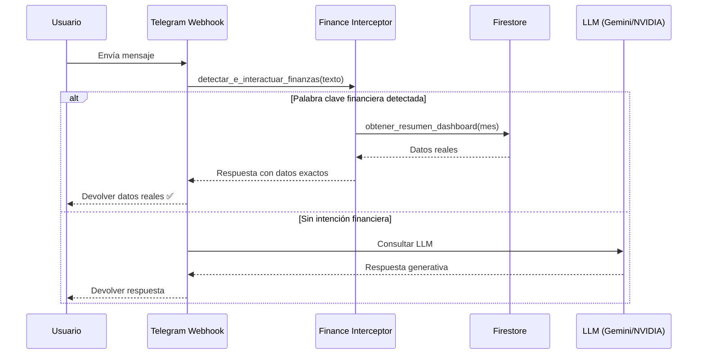

# Prevención de Alucinaciones Financieras en LLM

## Problema

Los modelos de lenguaje (Gemini, NVIDIA NIM/Llama) **no tienen acceso a Firestore** y no pueden consultar datos financieros reales. Cuando reciben preguntas como *"¿Cuál es tu presupuesto de julio?"*, al no tener los datos, los **inventa** (alucinación).

En la captura original se ve:
- "Cual es el presupuesto de septiembre" → ✅ Datos reales ($1.5M balance, $450k gastos)
- "Cual es tu presupuesto de julio" → ❌ Alucinado ($15,400 inventados)

## Solución: Interceptor Heurístico

Se implementó `modules/finance/interceptor.py` que se ejecuta **ANTES** de cualquier llamada a LLM.

### Flujo de Protección

### Palabras Clave Interceptadas

| Término | Categoría |
|---------|-----------|
| presupuesto, presupuestos | Límites y uso |
| gasto, gastos | Gastos del mes |
| balance, saldo | Balance general |
| ingreso, ingresos | Ingresos |
| cuánto tengo, cuanto tengo | Balance personal |
| debo, deuda, deudas | Pasivos |
| préstamo, prestamos | Préstamos |
| dinero, plata | Consulta de saldo |

### Detección de Mes

El interceptor extrae meses mencionados en español:
- "presupuesto de julio" → `2026-07`
- "gastos de septiembre 2026" → `2026-09`
- "2026-05" → `2026-05` (formato explícito)
- Sin mes mencionado → usa el último mes con datos activos

## Ubicación del Código

- **Interceptor**: `modules/finance/interceptor.py`
- **Integración**: `app/routes/telegram.py` (línea ~80, antes del router NLP)
- **Datos**: `modules/finance/dashboard.py::obtener_resumen_dashboard()`

## Estado

- **Fecha de implementación**: 2026-10-13
- **Estado**: Activo
- **Tags**: [[Firebase]], [[Finanzas]], [[Python]], [[FastAPI]], [[Telegram]]
