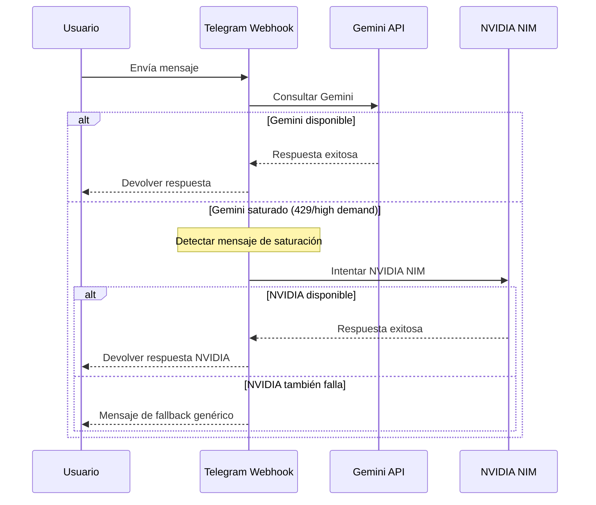

# Integración NVIDIA NIM con Rotación de API Keys

## Arquitectura

JARVIS ahora integra **NVIDIA NIM** como proveedor de respaldo (fallback) cuando Gemini API está saturado o alcanza sus límites de tasa.

### Flujo de Respuesta



## Configuración

### Variables de Entorno

| Variable | Tipo | Descripción |
|----------|------|-------------|
| `NVIDIA_API_KEYS` | string | Pool de claves NVIDIA separadas por comas |
| `NVIDIA_API_KEY` | string | Clave única (alternativa a la anterior) |
| `NVIDIA_MODEL` | string | Modelo a usar (default: `meta/llama-3.1-70b-instruct`) |

### Ejemplo `.env`

```bash
NVIDIA_API_KEYS=nvapi-key1,nvapi-key2,nvapi-key3
# Opcional: especificar modelo diferente
# NVIDIA_MODEL=meta/llama-3.1-70b-instruct
```

## Implementación

### Módulos Creados

1. **`modules/nvidia/client.py`** — Cliente HTTP asíncrono con:
   - Carga perezosa de keys desde variables de entorno
   - Rotación aleatoria del pool de claves
   - Manejo de errores 429/503 (rate limit)
   - Timeout de 30 segundos por petición

2. **`modules/nvidia/think.py`** — Wrapper síncrono con manejo de excepciones

3. **`modules/nvidia/__init__.py`** — Inicialización del módulo

### Integración con Telegram

En `app/routes/telegram.py`:
- Se importa `pensar_respuesta_nvidia` desde `modules.nvidia.think`
- Después de obtener respuesta de Gemini, se verifica si contiene mensajes de saturación
- Si es así, se intenta el fallback a NVIDIA NIM
- Si NVIDIA también falla, se retorna mensaje genérico de error

## Estrategia de Rotación

El sistema implementa rotación mediante:
1. **Barajado aleatorio** de claves al iniciar cada consulta
2. **Fallback secuencial** ante errores 429/503
3. **Logging detallado** de cada intento fallido

Esto permite:
- Distribuir carga entre múltiples cuentas NVIDIA
- Maximizar disponibilidad del servicio
- Evitar bloqueos por límites de tasa individuales

## Modelos Soportados

Por defecto usa `meta/llama-3.1-70b-instruct`, pero se puede configurar cualquier modelo compatible con el endpoint OpenAI de NVIDIA NIM:

- `meta/llama-3.1-70b-instruct` (default)
- `mistralai/mistral-large-2-instruct-2407`
- `nvidia/nemotron-4-340b-instruct`
- Otros según disponibilidad en [NVIDIA NIM](https://catalog.ngc.nvidia.com/ai-foundation-models)

## Limitaciones Actuales

- Requiere configuración manual de API keys
- No hay balanceo de carga ponderado por costo/latencia
- El fallback solo se activa para consultas generales (no para operaciones financieras determinísticas)

## Estado

- **Fecha de implementación**: 2026-10-13
- **Estado**: Activo (requiere configuración de keys)
- **Tags**: [[NVIDIA]], [[Python]], [[IA]], [[FastAPI]], [[Telegram]], [[Fallback]]
